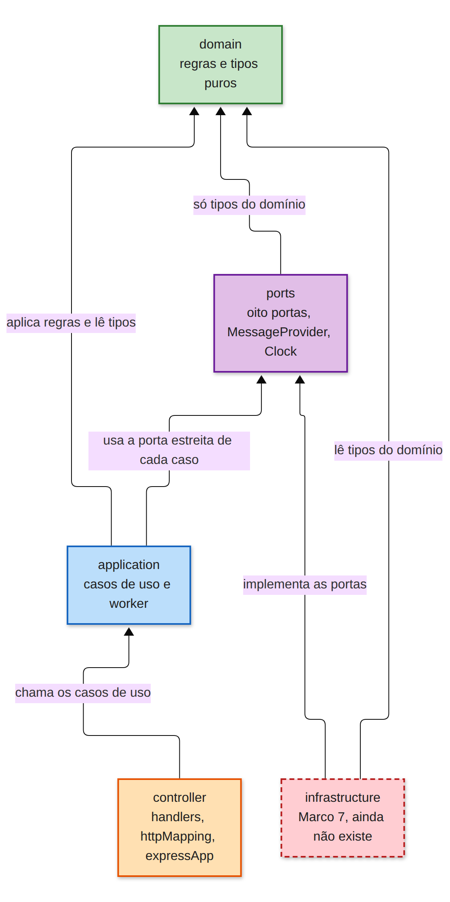

# campaign-messages

## O que é

API de campanhas de mensagens WhatsApp. Você sobe uma planilha de contatos junto com um texto com variáveis, a API valida cada linha, grava a campanha no MySQL e, quando você manda iniciar, um worker no mesmo processo envia as mensagens por um provedor. O provedor deste repositório é o `fakeProvider.js` da raiz, uma simulação: não existe WhatsApp real aqui.

O caminho de uma campanha tem quatro passos:

1. **Upload.** `POST /campaigns` recebe o `template` e a planilha `.xlsx`. A resposta 201 diz quantos contatos foram aceitos e quais foram rejeitados, e por quê. A campanha nasce em `draft`.
2. **Início.** `POST /campaigns/:id/start` passa a campanha para `running`. Nada é enviado dentro da requisição; ela só libera o worker.
3. **Envio pelo worker.** A cada 200 ms o worker reivindica até 5 mensagens `queued`, chama o provedor e grava o resultado. Sucesso vira `sent`, com o id do provedor guardado. Quando não sobra nenhuma `queued`, a campanha vira `finished`.
4. **Webhook.** O provedor falso não emite webhooks. `delivered`, `read` e `failed` depois de um aceite só chegam por `POST /webhooks/provider`, e quem faz essa chamada é você (ou o provedor real, em produção). Cada evento move a mensagem e atualiza os totais de `GET /campaigns/:id`.

## Design e por quê

<p align="center">
  
</p>

A seta aponta para o que a caixa precisa para existir. O domínio não conhece Express, MySQL nem planilha: ele só tem regras e tipos. Só o `src/main.ts` constrói as classes concretas (repositório MySQL, fachada da planilha, provedor, relógio, casos de uso e worker) e as liga umas às outras.

### Casos de uso e HTTP

Um caso de uso devolve uma união discriminada (`{ kind: 'created', ... }`, `{ kind: 'not_found' }` e assim por diante) e nunca um status HTTP. Quem traduz é o `src/controller/httpMapping.ts`: criação vira 201, início vira 202, consulta e webhook viram 200, entrada inválida vira 400, campanha inexistente vira 404 e o limite de criações simultâneas vira 429. Os corpos de erro são sempre `{}`. Por isso um caso de uso pode ser testado sem Express e a mesma regra serviria a outro transporte.

### Oito portas estreitas

O repositório é a interseção de oito interfaces pequenas em `src/ports/campaignRepository.ts`. Cada caso de uso recebe só a que chama, então um cliente nunca depende do repositório inteiro.

| Porta | Método | Quem chama |
|---|---|---|
| `CampaignCreator` | `createCampaignWithMessages` | `CreateCampaign` |
| `CampaignSummaryReader` | `getSummary` | `GetCampaign` e `FinishCampaignIfDone` |
| `CampaignFailureReader` | `listFailures` | `ListCampaignFailures` |
| `CampaignStarter` | `markRunningIfDraft` | `StartCampaign` |
| `CampaignFinisher` | `markFinished` | `FinishCampaignIfDone` |
| `DueMessageClaim` | `claimDue` | `SendWorker` |
| `MessageOutcomeStore` | `recordSent`, `recordRetry`, `recordFailed` | `ProcessClaimedMessage` |
| `ProviderWebhookStore` | `applyWebhookEvent` | `ApplyProviderWebhook` |

Criar, reivindicar (claim) e o par do webhook continuam atômicos dentro do `MySqlCampaignRepository`. O caso do webhook é o mais delicado: o adaptador segura uma única transação com a mesma conexão por `webhook_open`, pela decisão em TypeScript (`decideWebhook`, que recebe o estado atual da mensagem) e por `webhook_apply`. O lock de linha que `webhook_open` toma continua preso até o commit, então dois eventos da mesma mensagem não se cruzam.

### MySQL

O adaptador só executa `CALL` de stored procedures (`mysql/002_procedures.sql`); não há SQL solto no código. Os códigos de status ficam em tabelas de lookup (`campaign_statuses`, `message_statuses`) e as tabelas principais referenciam o id inteiro. Nenhuma coluna aceita `NULL`. Um fato opcional ganha tabela própria, e só existe a linha quando o fato existe: `message_provider_ids` (id devolvido pelo provedor), `message_failures` (motivo da falha), `message_claims` (mensagem reivindicada pelo worker) e `webhook_events` (eventos já vistos, para a idempotência).

### Planilha

`POST /campaigns` é `multipart/form-data` com dois campos: `template` (texto) e `spreadsheet` (o arquivo). A fachada (`SpreadsheetFacade`) escolhe o leitor pela extensão do nome do arquivo: o trecho depois do último ponto, em maiúsculas, então `pasta.backup.xlsx` vira `XLSX`. Só `XLSX` tem leitor. Qualquer outra extensão, ou arquivo sem ponto no nome, é 400 e o caso de uso nem é chamado.

O leitor lê a primeira aba. A linha de cabeçalho é a primeira linha em que alguma célula, depois de `trim`, minúsculas e remoção de acentos, bate com um sinônimo de telefone: `phone`, `telefone`, `celular`, `whatsapp` ou `fone`. As linhas acima dela são ignoradas, o que permite títulos ou observações no topo. A coluna de telefone nunca é escolhida pela quantidade de dígitos das células; só pelo cabeçalho. Dois cabeçalhos de telefone na mesma linha invalidam o arquivo (400), assim como a ausência de qualquer um.

Cada `{{chave}}` do template (qualquer nome que case com `[A-Za-z0-9_]+`) procura uma coluna com esse cabeçalho, ou um apelido cadastrado em `VARIABLE_HEADER_ALIASES`, que hoje está vazio. Colunas que nenhuma chave usa são ignoradas. Chave sem coluna não rejeita o arquivo: cada contato volta como `missing_variable`. Linhas totalmente vazias são puladas.

Para cada contato a validação segue esta ordem, e o primeiro motivo que bater rejeita:

1. `invalid_number`: o telefone, só com dígitos, precisa ter de 10 a 15 dígitos e não pode terminar em `0000`.
2. `missing_variable`: alguma chave do template falta ou está com string vazia.
3. `duplicate`: o mesmo telefone normalizado já foi aceito nesta campanha. O primeiro vale.

Uma linha suja não derruba o lote. Se todos os contatos forem rejeitados, a campanha ainda é criada, com `accepted: 0`. Os rejeitados não são gravados: o corpo do 201 é o único registro deles, a lista não pode ser editada depois e a campanha não tem nome.

### Memória e limite de criações

O multer usa `memoryStorage` com teto de 5 MiB por arquivo; o arquivo nunca vai para o disco. O limite de 5 criações simultâneas roda antes do multer, então a sexta requisição recebe 429 `{}` sem alocar nenhum buffer. Não há fila: ou existe vaga, ou a resposta é 429. A vaga é devolvida quando a resposta termina ou a conexão fecha, o que vier primeiro.

### Worker

O worker roda no mesmo processo da API e acorda a cada 200 ms. O intervalo vem de `WORKER_POLL_INTERVAL_MS`, lida em `main.ts`; o Compose não repassa essa variável, então no contêiner vale 200. Em cada tick ele reivindica no máximo `5 - em voo` mensagens. Uma espera de retry não ocupa vaga: ela é só o `next_attempt_at` da mensagem, que volta a ser elegível quando a hora chega. Um claim com mais de 30 segundos pode ser tomado de novo, que é como uma mensagem presa por um processo caído volta para a fila.

Se o provedor responde 400, a mensagem falha na hora, com motivo `invalid_number` ou `invalid_payload`. Qualquer outro erro é transitório: a mensagem espera 200 ms, 800 ms e 2 s, uma espera por tentativa, e depois de esgotar vira `failed` com `provider_unavailable`.

O `fakeProvider.js` se comporta assim: `to` ou `body` que não sejam string, ou `body` vazio, dão 400 `invalid_payload`; um `to` que termina em `0000` dá 400 `invalid_number`; uma fração `FAKE_FAIL_RATE` das chamadas (padrão 0.2, lida uma vez quando o módulo carrega) dá 503 `provider_unavailable`; a latência fica entre 50 e 200 ms; o sucesso devolve `pm_` mais um uuid. Ele não chama o webhook.

### Estados

A campanha tem `draft`, `running` e `finished`. Iniciar uma `draft` responde 202 `running`, mesmo que nenhum contato tenha sido aceito; nesse caso a campanha passa a `finished` logo em seguida. Um segundo start não envia nada de novo e devolve o status já gravado. `finished` nunca volta a `running`, mas um webhook que chegue depois ainda atualiza os totais.

A mensagem tem `queued`, `sent`, `delivered`, `read` e `failed`. Uma mensagem reivindicada pelo worker continua contando como `queued` nos totais. O webhook segue estas regras:

- `delivered` só vale a partir de `sent`.
- `read` vale a partir de `sent` ou `delivered`, e não é contado também como `delivered`.
- `failed` vale a partir de `sent`, `delivered` ou `read`, com o `reason` do corpo ou `provider_failed`.
- Um movimento para trás, como qualquer evento depois de `failed`, ou um evento com a mensagem ainda `queued`, é ignorado. Se o `provider_message_id` existe, o `event_id` é gravado mesmo assim.
- Um `event_id` repetido responde 200 e não muda nada.
- Um `provider_message_id` desconhecido responde 200 e não é gravado.

## Como rodar

Requisito: Node 18 ou mais novo. Para subir tudo:

```bash
docker compose up
```

| Serviço | Porta | Papel |
|---|---|---|
| `api` | 3000 | A API e o worker. Espera o `mysql-migrate` terminar. |
| `mysql` | 3306 | MySQL 8 do app. Banco `campaign_messages`, usuário `campaign`, senha `campaign`, root `root`. |
| `mysql-migrate` | sem porta | Roda uma vez, aplica `mysql/001_schema.sql` e `mysql/002_procedures.sql` e termina. É idempotente. |
| `sonarqube` | 9000 | SonarQube Community. |
| `sonar-db` | sem porta publicada | Postgres do SonarQube, separado do MySQL do app. |
| `otel-collector` | 4318 | Recebe os traces por OTLP HTTP. |

O k6 não sobe com `docker compose up`; veja a seção [k6](#k6).

As variáveis ficam no `.env.example`; copie para `.env` se quiser mudar algo. Duas merecem atenção:

- `SENTRY_DSN` vazio deixa o Sentry desligado.
- `FAKE_FAIL_RATE` só chega ao contêiner `api` quando o host a define; sem ela, o provedor falso mantém 0.2. Para testar sem falhas transitórias: `FAKE_FAIL_RATE=0 docker compose up -d api`.

### Testes e typecheck

`npm test` roda o Jest com `--runInBand`. Os testes unitários não precisam de MySQL. As specs de integração em `tests/infrastructure/integration/` precisam de MySQL em `127.0.0.1:3306`, e uma conexão recusada faz essas specs falharem de propósito, para não passarem em silêncio sem banco. Se você só precisa do MySQL, não do resto da stack:

```bash
docker compose up -d mysql
docker compose up mysql-migrate
```

`npm run typecheck` roda `tsc --noEmit` e não precisa de MySQL.

### Entrar no container do banco de dados MySQL e verificar as tabelas

```bash
sudo docker compose exec mysql mysql -ucampaign -pcampaign campaign_messages
```

```bash
SHOW TABLES;

SELECT c.id, c.template, cs.code AS status
FROM campaigns c
JOIN campaign_statuses cs ON cs.id = c.status_id;

SELECT m.id, m.campaign_id, m.phone, m.body, ms.code AS status, m.attempt_count
FROM messages m
JOIN message_statuses ms ON ms.id = m.status_id;

SELECT * FROM message_provider_ids;
SELECT * FROM message_failures;
SELECT * FROM webhook_events;
```

## Exemplos de chamada

Todos contra `http://localhost:3000`, com a stack no ar.

### Criar a campanha

O arquivo precisa ser `.xlsx`, com uma linha de cabeçalho que tenha uma coluna de telefone (por exemplo `telefone`) e uma coluna para cada chave do template (aqui `nome` e `data`).

```bash
curl -X POST http://localhost:3000/campaigns \
  -F 'template=Olá {{nome}}, sua consulta é {{data}}.' \
  -F 'spreadsheet=@contatos.xlsx'
```

```json
{
  "id": 1,
  "accepted": 1,
  "rejected": [{ "phone": "123", "reason": "invalid_number" }]
}
```

O status é 201. Responde 400 `{}` para arquivo inválido ou ausente, extensão que não seja `XLSX`, `template` ausente ou planilha sem coluna de telefone. Responde 429 `{}` na sexta criação simultânea.

### Iniciar o envio

```bash
curl -X POST http://localhost:3000/campaigns/1/start
```

```json
{ "status": "running" }
```

Status 202. Id inexistente é 404 `{}`; id malformado é 400 `{}`.

### Ver os totais

```bash
curl http://localhost:3000/campaigns/1
```

```json
{
  "id": 1,
  "status": "running",
  "totals": { "queued": 0, "sent": 0, "delivered": 0, "read": 0, "failed": 0 }
}
```

Status 200. `totals` sempre traz os cinco números; os valores acima são só o formato, e mudam conforme o worker e os webhooks avançam.

### Listar as falhas

```bash
curl 'http://localhost:3000/campaigns/1/failures?page=1'
```

```json
{
  "items": [{ "phone": "5511999998888", "reason": "provider_unavailable" }],
  "page": 1,
  "pageSize": 50,
  "total": 1
}
```

Status 200. O `pageSize` é fixo em 50 e `page` ausente vale 1. Uma página inválida (zero, negativa ou não numérica) é 400 `{}`, e campanha inexistente é 404 `{}`.

### Webhook do provedor

Nenhuma rota devolve o `provider_message_id`; ele fica na tabela `message_provider_ids`. Para pegar um id de teste:

```bash
docker compose exec mysql mysql -ucampaign -pcampaign campaign_messages \
  -e 'SELECT message_id, provider_message_id FROM message_provider_ids LIMIT 5'
```

Depois mande o evento:

```bash
curl -X POST http://localhost:3000/webhooks/provider \
  -H 'Content-Type: application/json' \
  -d '{"event_id":"evt-1","provider_message_id":"pm_1b9c...","status":"delivered"}'
```

```json
{}
```

Status 200. `status` aceita `delivered`, `read` e `failed`; `reason` só conta em `failed`. Mandar o mesmo `event_id` de novo, ou um `provider_message_id` que não existe, também responde 200 `{}`. Um corpo sem `event_id`, sem `provider_message_id` ou com `status` fora dessa lista é 400 `{}`.

### Saúde

```bash
curl http://localhost:3000/health
```

```json
{ "status": "ok" }
```

## SonarQube

A análise cobre só `src` (`sonar.sources=src`). A suíte de testes não é analisada, e o `sonar-project.properties` não tem caminho de relatório de cobertura, então a cobertura do Jest não é enviada ao Sonar. O banco do Sonar é o `sonar-db` (Postgres), não o MySQL do app. `SONAR_ES_BOOTSTRAP_CHECKS_DISABLE=true` está ligado no Compose para o servidor subir numa máquina pequena.

Abra `http://localhost:9000`. O primeiro login da imagem é `admin` / `admin`, e a interface em seguida exige uma senha nova. Crie um token pela interface e exporte como `SONAR_TOKEN`.

O scanner não é um script npm e não é dependência deste repositório. Instale o `sonar-scanner` no host e rode na raiz do projeto, com o servidor do Sonar no ar:

```bash
sonar-scanner \
  -Dsonar.host.url=http://localhost:9000 \
  -Dsonar.token="$SONAR_TOKEN"
```

A URL e o token ficam fora do repositório de propósito. Depois da execução o resultado aparece no projeto `campaign-messages` na interface.

## OpenTelemetry e Sentry

Os traces vão para o collector; os erros vão para o Sentry, e só quando `SENTRY_DSN` está preenchido. `startTelemetry()` (em `src/telemetry.ts`) é chamada no começo do `bootstrap()` de `main.ts`, antes de o app Express ser montado, com a intenção de as instrumentações de HTTP e de Express alcançarem o módulo. Atenção: `main.ts` importa `expressApp` de forma estática, e em CommonJS esse `require` acontece antes de `startTelemetry()`. Por isso, confirme nos logs do collector que os spans de rota aparecem; se não aparecerem, esse é o primeiro lugar para olhar.

O exporter acrescenta `/v1/traces` ao `OTEL_EXPORTER_OTLP_ENDPOINT`; no Compose o valor é `http://otel-collector:4318`. O `otel/collector.yaml` usa o exporter `debug` com `verbosity: basic`, então cada requisição aparece como linhas de log, não numa interface:

```bash
docker compose logs otel-collector
```

Se a inicialização do OpenTelemetry lançar um erro, ele é registrado no log e o processo continua e escuta normalmente.

No Sentry, o `Sentry.setupExpressErrorHandler` é registrado em `main.ts`. Com o DSN vazio o Sentry não é inicializado e nenhum evento sai. Não existe serviço Sentry no Compose: você usa um projeto seu. Para ligar, defina `SENTRY_DSN` e recrie o contêiner da API:

```bash
SENTRY_DSN='https://chave@oXXXX.ingest.sentry.io/YYYY' docker compose up -d --force-recreate api
```

O `skipOpenTelemetrySetup` impede que o Sentry instale um segundo tracer; os traces ficam só com o OpenTelemetry e o Sentry cuida de erros.

## k6

Um VU é um usuário virtual que repete o script em laço. O `k6/health.js` usa 10 VUs por 30 segundos, dorme 0,1 s entre as chamadas e faz `GET /health`. Os limites são: menos de 1% de requisições com falha e p95 abaixo de 300 ms. Se algum limite falhar, o k6 sai com código diferente de zero, o que serve para CI.

No Compose o `BASE_URL` é `http://api:3000`. O serviço está no profile `load`, então só roda quando pedido:

```bash
docker compose --profile load run --rm k6
```

A API precisa estar de pé; o k6 depende do healthcheck dela. Não há cenário de campanha: uma criação exigiria montar uma planilha por requisição e bateria no limite de 5 criações simultâneas, o que mediria o 429 e não a API.

## O que ficaria para produção

Nada disto está implementado.

**Chave de API.** Hoje todas as rotas são abertas. Em produção cada chamada precisaria de uma chave, validada antes de qualquer caso de uso, e a chave deveria ser por cliente para poder ser revogada.

**Assinatura do webhook.** Hoje quem alcança a porta consegue postar um evento e mudar o estado de uma mensagem. Um provedor real assina o corpo; a API deveria verificar essa assinatura antes de chamar `ApplyProviderWebhook` e recusar o que não bater.

**Worker separado.** O worker vive no processo da API, então uma queda da API para o poll também. Os claims com mais de 30 segundos são o que faz uma reinicialização pegar de volta as mensagens que ficaram no meio; um processo próprio para o worker permitiria escalar e reiniciar os dois de forma independente.

**Provedor real de WhatsApp.** Uma nova classe implementa `MessageProvider` e o `main.ts` a passa no lugar do `FakeProviderAdapter`. O caso de uso `ProcessClaimedMessage` continua o mesmo, porque só conhece a porta.

**Retentativa do 429.** O servidor responde 429 e esquece a requisição. Quem reenvia é o cliente: espera 1 segundo e manda o mesmo multipart de novo. Esse segundo envio é uma criação nova, não a retomada da primeira; o servidor não guarda fila nem upload.

**CI/CD.** Automatizar compilação da imagem docker, testes, push para o registry e implantação usando, por exemplo, Git Actions.

**Proxy.** Criar proxy para receber e balancear as requisições, usando, por exemplo, nginx.
